<picture>
  <source media="(prefers-color-scheme: dark) and (max-width: 600px)" srcset="./assets/profile-hero-dark-mobile.svg" />
  <source media="(max-width: 600px)" srcset="./assets/profile-hero-light-mobile.svg" />
  <source media="(prefers-color-scheme: dark)" srcset="./assets/profile-hero-dark.svg" />
  
</picture>

 

  <strong>Useful models. Reliable systems.</strong> 
  I build ML tooling, inference pipelines and AI products — 
  with Python and Go behind the systems that run them.

  
  
  

 

## 01 / Selected engineering

### [TinyModel Lab ↗](https://github.com/rezvvent/tinymodel-lab)

**Understand the model. Measure the trade-offs.** A toolkit for architecture profiling, validated ONNX export and reproducible inference benchmarks. Parameter counts, memory, numerical parity and p50–p99 latency — measured through real execution.

`PyTorch` `torchvision` `ONNX Runtime` `Transformers` `Python` `CLI`

### [Salary ML ↗](https://github.com/rezvvent/prod-hackathon-salary-ml)

**Take tabular ML through the full delivery loop.** A salary-range prediction service with CatBoost quantile regression, feature engineering, grouped validation, MLflow tracking, ONNX export and a FastAPI serving layer.

`CatBoost` `scikit-learn` `MLflow` `ONNX` `FastAPI` `Prometheus` `Docker`

### [StrideLab ↗](https://github.com/rezvvent/StrideLab)

**Watch learning emerge from a feedback loop.** A neural controller evolves a walking policy in real 2D physics. Parallel evaluation, seeded experiments and fixed validation starts keep progress visible and comparisons meaningful.

`Neuroevolution` `Neural networks` `Planck.js` `Web Workers` `TypeScript`

### [AI Clipboard ↗](https://github.com/rezvvent/ai-clipboard)

**Make AI useful inside a daily workflow.** A native macOS app with server-side Gemini search, contextual transformations, encrypted synchronization and a FastAPI / PostgreSQL backend.

`Gemini API` `LLM applications` `SwiftUI` `FastAPI` `PostgreSQL`

<strong>More systems behind the models</strong>

 

| Project | Engineering focus |
| :--- | :--- |
| [**ShortLab**](https://github.com/rezvvent/url-shortener-analytics) | Go redirects, Kafka event streams, Redis and live click analytics. |
| [**CodeArena**](https://github.com/rezvvent/codearena) | Isolated code execution, asynchronous judging and live verdicts. |
| [**ScamShield**](https://github.com/rezvvent/ScamShield) | Explainable website risk signals, FastAPI and SSRF protection. |
| [**PocketDeck**](https://github.com/rezvvent/PocketDeck) | Raspberry Pi operations, Docker health and ESP32 messaging. |
| [**PickOne**](https://github.com/rezvvent/pickone) | Real-time polls, shareable rooms and a lightweight web experience. |

 

## 02 / Engineering toolkit

  
  
  
  
  
  

<!-- The main toolkit reflects public project dependencies and the existing profile. -->

| Layer | Technologies & methods |
| :--- | :--- |
| **Languages** | Python · Go · SQL · TypeScript · Bash · Swift |
| **Deep learning** | PyTorch · torchvision · Hugging Face Transformers · neural architectures · vision models |
| **Tabular ML** | scikit-learn · CatBoost · LightGBM · quantile regression · feature engineering · TF-IDF |
| **Data science** | NumPy · pandas · Matplotlib · Seaborn · EDA · data validation |
| **Experiments** | MLflow · Optuna · baselines · grouped holdouts · reproducible evaluation |
| **Inference** | ONNX · ONNX Runtime · ONNX Script · CUDA / MPS execution · latency percentiles · throughput · memory profiling |
| **Applied AI** | Gemini API · OpenAI API · LLM integrations · semantic search · context handling · AI workflows |
| **Backend** | FastAPI · Pydantic · asyncio · Gin · Fiber · gRPC · REST · WebSockets · Celery |
| **Data systems** | PostgreSQL · Redis · MongoDB · Kafka · RabbitMQ · Elasticsearch · SQLAlchemy |
| **Delivery** | Docker · Docker Compose · Linux · NGINX · GitHub Actions · Kubernetes · Terraform |
| **Reliability** | pytest · Ruff · integration tests · structured logging · Prometheus · Grafana |

<strong>Expand the ML / AI research radar — LLMs, retrieval, optimization & MLOps</strong>

 

A wider technology map for experimentation and future projects.

| Area | Tools & concepts |
| :--- | :--- |
| **LLM adaptation** | PEFT · LoRA · QLoRA · TRL · SFT · preference optimization · dataset curation |
| **Training at scale** | Accelerate · DeepSpeed · PyTorch DDP / FSDP · mixed precision · gradient checkpointing · distributed training |
| **Efficient models** | quantization · pruning · knowledge distillation · torch.compile · TensorRT · TensorRT-LLM |
| **LLM serving** | vLLM · Hugging Face TGI · llama.cpp · Ollama · Triton Inference Server · BentoML |
| **NLP & embeddings** | Sentence Transformers · tokenizers · text embeddings · cross-encoders · reranking · semantic similarity |
| **Retrieval & RAG** | LangChain · LlamaIndex · Haystack · FAISS · Qdrant · pgvector · Milvus · hybrid search · chunking |
| **Agents & orchestration** | LangGraph · Model Context Protocol · tool calling · structured outputs · workflow state · human review |
| **Evaluation** | Ragas · DeepEval · lm-evaluation-harness · retrieval metrics · regression datasets · error analysis |
| **Data systems** | Polars · PyArrow · DuckDB · Hugging Face Datasets · DVC · Great Expectations |
| **ML platforms** | Ray · Airflow · Prefect · Kubeflow · model registries · dataset versioning · reproducible pipelines |
| **AI observability** | Langfuse · Arize Phoenix · Evidently · OpenTelemetry · drift detection · cost / latency tracing |
| **Vision & multimodal** | OpenCV · timm · Albumentations · Diffusers · image embeddings · OCR · vision-language models |

 

## 03 / How I approach ML systems

| Stage | The questions that matter |
| :--- | :--- |
| **Frame** | What is the baseline, the data split and the actual success criterion? |
| **Experiment** | Can the result be reproduced? Where does the model fail? |
| **Evaluate** | What changed in quality, latency, memory and throughput? |
| **Deliver** | Are model inputs validated, artifacts versioned and failures observable? |
| **Operate** | How do we detect regressions, investigate drift and roll back safely? |

 

## 04 / In motion

<a href="https://github.com/rezvvent?tab=overview">
  <picture>
    <source media="(prefers-color-scheme: dark)" srcset="https://raw.githubusercontent.com/rezvvent/rezvvent/output/contribution-snake-dark.svg" />
    
  </picture>
</a>

 

---

  <strong>Have a model to ship or a system to make reliable?</strong> 
  Let's build something useful.

  <a href="https://t.me/rezvent"><strong>Telegram ↗</strong></a>
  &nbsp;&nbsp; / &nbsp;&nbsp;
  <a href="mailto:brxdeveloper@gmail.com"><strong>Email ↗</strong></a>
  &nbsp;&nbsp; / &nbsp;&nbsp;
  <strong>Discord:</strong> @rezvvent

