<picture>
  <source media="(max-width: 600px)" srcset="./assets/atlas-hero-mobile.svg" />
  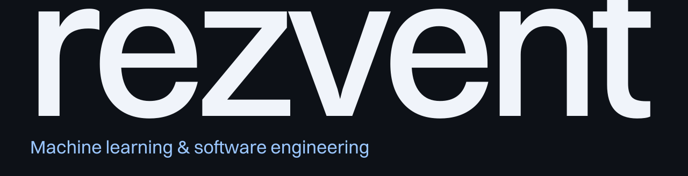
</picture>

# ML & AI engineer

ML ML ML ML!!!!!!

  
  &nbsp;&nbsp; <a href="mailto:brxdeveloper@gmail.com">Email</a>
  &nbsp;&nbsp; Discord:&nbsp;<strong>@rezvvent</strong>

[ML & AI](#ml--ai) &nbsp; · &nbsp; [Frontend](#frontend) &nbsp; · &nbsp; [Backend](#backend) &nbsp; · &nbsp; [Infrastructure](#infrastructure) &nbsp; · &nbsp; [Projects](#selected-projects)

 

## ML & AI

From data and model training to retrieval, local inference, evaluation and delivery.

### Data & scientific computing

  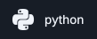
  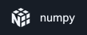
  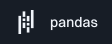
  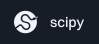
  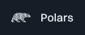
  
  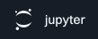
  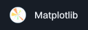
  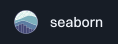
  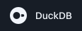

### Modeling & optimization

  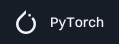
  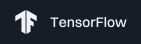
  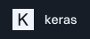
  
  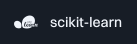
  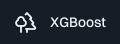
  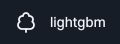
  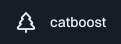
  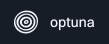

### Hugging Face ecosystem

  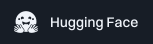
  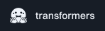
  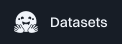
  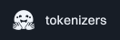
  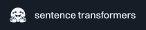
  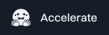
  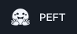
  
  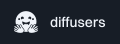
  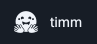

### Fine-tuning & training

  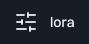
  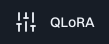
  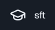
  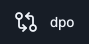
  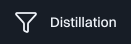
  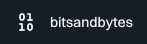
  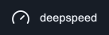
  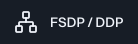
  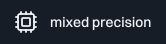

### Inference & local models

  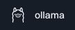
  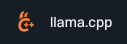
  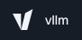
  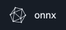
  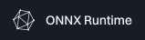
  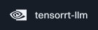
  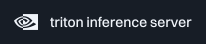
  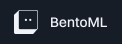
  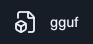
  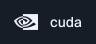

### Vector databases & retrieval

  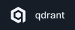
  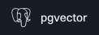
  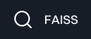
  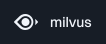
  
  
  
  
  
  
  

### Agents & orchestration

  
  
  
  
  
  
  
  
  
  

### Model APIs & open weights

  
  
  
  
  
  
  

### Vision & multimodal

  
  
  
  
  
  

### MLOps & evaluation

  
  
  
  
  
  
  
  
  
  
  
  
  

 

## Frontend

### Languages & interfaces

  
  
  
  
  
  
  
  
  
  
  

### State, forms & quality

  
  
  
  
  
  
  
  
  
  
  
  

 

## Backend

### Languages, frameworks & APIs

  
  
  
  
  
  
  
  
  
  
  
  
  
  
  
  

### Databases, caching & messaging

  
  
  
  
  
  
  
  
  
  
  
  

 

## Infrastructure

### Delivery & observability

  
  
  
  
  
  
  
  
  
  
  
  
  
  

 

## Selected projects

- [**TinyModel Lab**](https://github.com/rezvvent/tinymodel-lab) — Model profiling, ONNX export and inference benchmarks.
- [**Salary ML**](https://github.com/rezvvent/prod-hackathon-salary-ml) — CatBoost salary prediction with MLflow and FastAPI.
- [**StrideLab**](https://github.com/rezvvent/StrideLab) — Neural controllers learning to walk through neuroevolution.
- [**AI Clipboard**](https://github.com/rezvvent/ai-clipboard) — macOS clipboard with Gemini search and encrypted sync.
- [**CodeArena**](https://github.com/rezvvent/codearena) — Isolated code execution and live judging.
- [**ShortLab**](https://github.com/rezvvent/url-shortener-analytics) — Go redirects, Kafka events and live analytics.
- [**ScamShield**](https://github.com/rezvvent/ScamShield) — Website risk analysis with explainable signals.
- [**PocketDeck**](https://github.com/rezvvent/PocketDeck) — Raspberry Pi, Docker and ESP32 control center.
- [**PickOne**](https://github.com/rezvvent/pickone) — Shareable real-time polls.

 

## Let’s build

